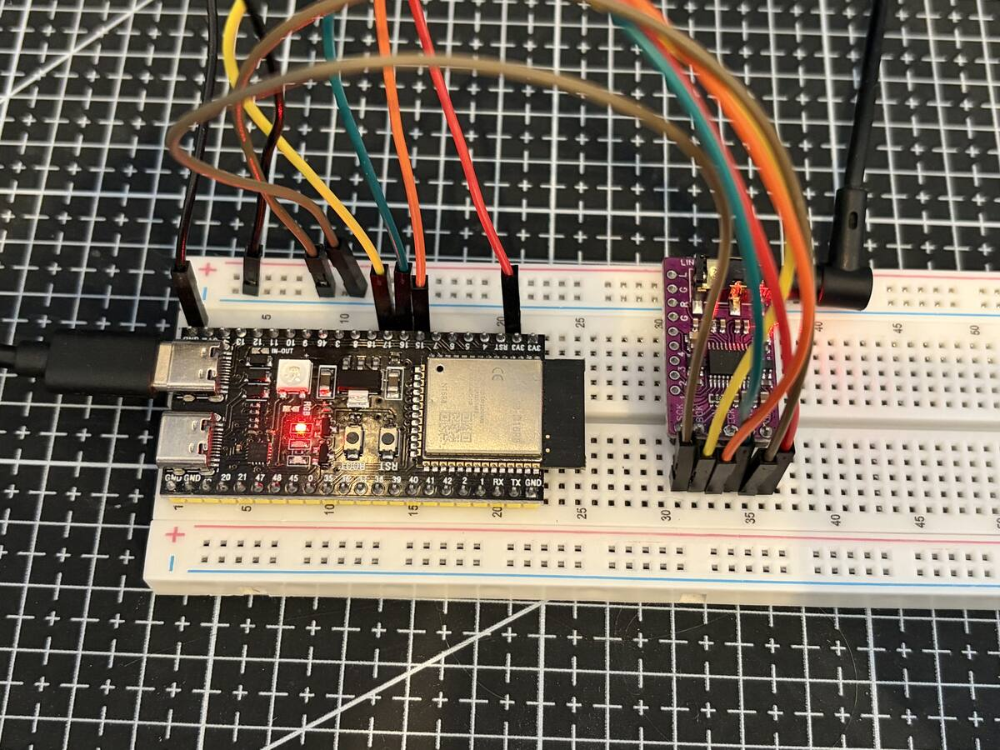
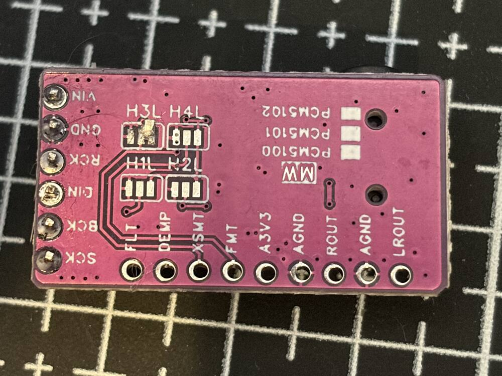

# Shard

Shard is a reverse-engineered reimplementation of Obsidian, the synthesizer inside NanoStudio 2, by Blip Interactive.

Obsidian is volcanic glass, and a shard is a piece broken off it. The name fits what the project tries to be: a fragment of the original that keeps its shape, small enough to run on a microcontroller and documented well enough to be rebuilt anywhere else.

I think Obsidian is an excellent synth, and since NanoStudio 2 was discontinued I'd like to preserve the work Matt put into it as faithfully as possible.

This repository has two parts. The main one is a written specification of how Obsidian works: its signal flow, every oscillator, filter, envelope, LFO and effect, the modulation matrix, and the file formats for presets and wavetables. The goal is that anyone can implement it on any platform. The second part is a working port to an ESP32-S3, the first platform I picked. I'm doing a lot of the detailed work with help from Opus 5.5.

The first results surprised me. I had no idea an ESP32 could produce sounds this polished.

This is a work in progress. It will be open source, or at least a full write-up of a project I think was really well made, once it's polished enough to put out.

## The specification

The documentation lives in [`docs/obsidian`](docs/obsidian/README.md).

| Document | What it covers |
|---|---|
| [01 Architecture](docs/obsidian/01-architecture.md) | Signal flow, the voice, modules and the internal class map |
| [02 Preset format](docs/obsidian/02-preset-format.md) | The `.obs` XML format, attribute by attribute, including unison and performance controls |
| [03 Oscillators](docs/obsidian/03-oscillators.md) | Analog, Wavetable, NanoSaw, PD, FM, Noise and Sample |
| [04 Filters](docs/obsidian/04-filters.md) | The ladder and digital filters, waveshapers, formant, comb, routing and the global filter |
| [05 Envelopes and LFOs](docs/obsidian/05-envelopes-lfos.md) | The 5 envelopes and 5 LFOs, curves and timing |
| [06 Modulation](docs/obsidian/06-modulation.md) | Matrix sources, destinations and scaling |
| [07 Effects](docs/obsidian/07-effects.md) | Multi-FX, delay and reverb |
| [08 Wavetable format](docs/obsidian/08-wavetable-format.md) | The binary `.tbl` format |
| [09 Open questions](docs/obsidian/09-open-questions.md) | What is still unknown and how to find out |
| [10 Porting notes](docs/obsidian/10-porting-notes.md) | Design decisions for the ESP32 and web ports, measurements and current status |

The sources are the NanoStudio 2 app bundle (version 2.1.2): its 312 factory presets, the manual, the wavetables and the binary. Every claim in the documents carries a mark that says where it comes from: `[P]` observed in presets or measured against NanoStudio 2 renders, `[M]` stated in the manual, `[B]` read from the binary, `[I]` a reasonable inference, `[?]` unknown. When you implement something, the marks tell you how much to trust it.

Many of the numbers come from measurements: a set of test patches is rendered by NanoStudio 2 itself and compared against the port, so the documents record things like the level of each oscillator type, how the delay mixes dry and wet, or how fast each reverb type decays.

To implement Obsidian elsewhere, start with [01](docs/obsidian/01-architecture.md) and [02](docs/obsidian/02-preset-format.md), then [10](docs/obsidian/10-porting-notes.md) for the order in which features matter (by how often the factory presets use them). The ESP32 engine in [`firmware/obsidian_esp32/synth.h`](firmware/obsidian_esp32/synth.h) is a complete reference implementation in portable C++17 with no platform dependencies inside the DSP code.

## The ESP32-S3 port

### Hardware

- An ESP32-S3-DevKitC-1 N16R8: 16 MB of flash, 8 MB of PSRAM, and a second USB-C port you can use to plug in a MIDI keyboard.
- A PCM5102 DAC module, wired over I2S.

<p align="center">
  
</p>

| PCM5102 | ESP32-S3 |
|---|---|
| BCK | GPIO17 |
| RCK (LRCK) | GPIO16 |
| DIN | GPIO15 |

The PCM5102 module doesn't work out of the box: on the back, bridge pads 2 and 3 of the H3L jumper with solder. The pads are small and close together, so it's a bit tricky.

<p align="center">
  
</p>

### What it does

- 10 voices at 48 kHz, 16-bit stereo. Each voice has 3 oscillators, 2 filters, 5 envelopes, 5 LFOs and the modulation matrix. Voices render on one core and the reverb on the other.
- Presets are loaded from a content image in flash that you build from your own NanoStudio 2 installation: with the factory presets plus some of your own, mine holds 448 presets, 23 wavetables and 57 samples (13.8 MB).
- MIDI over USB and Bluetooth LE: notes, pitch bend, sustain, Program Change, MIDI clock (the tempo of tempo-synced LFOs and delays) and CCs you can assign with MIDI learn. A Korg nanoKEY Studio is mapped out of the box: the 8 pads pick preset categories, and the 8 knobs control cutoff, resonance, attack, release, LFO rate, LFO amount, reverb and volume.
- A serial console at 115200 baud for playing notes, choosing presets (`list`, `find`, `preset`), setting parameters, assigning CCs (`learn`) and reading the CPU load (`stat`). Type `help` for the full list.

### Building and flashing

You need Arduino-ESP32 3.3.x with `arduino-cli`, `esptool` and Python 3.

The firmware decides how the native USB port behaves from the board's USB Mode:

- `USB-OTG (TinyUSB)` (`USBMode=default`): the board is a USB-MIDI device for your computer, and the serial console shares the same port.
- `Hardware CDC and JTAG` (`USBMode=hwcdc`): the board is a USB host, so a class-compliant MIDI keyboard plugs straight into the native port. Use the other USB-C port (UART) for flashing and the console.

Build and upload the app, here as a USB-MIDI device:

```bash
cd firmware/obsidian_esp32
arduino-cli compile --fqbn esp32:esp32:esp32s3:PSRAM=opi,FlashSize=16M,CPUFreq=240,USBMode=default,CDCOnBoot=cdc .
arduino-cli upload -p <port> --fqbn esp32:esp32:esp32s3:PSRAM=opi,FlashSize=16M,CPUFreq=240,USBMode=default,CDCOnBoot=cdc,UploadMode=cdc .
```

The sketch ships its own `partitions.csv`: a 2 MB app at `0x10000` and a 14.2 MB `content` partition at `0x210000`.

Then build the content image from your NanoStudio 2 presets and write it to the content partition. It only needs rewriting when the presets change.

```bash
python3 -I firmware/tools/content2bin.py content.bin \
  "/Applications/NanoStudio 2.app/Wrapper/NanoStudio 2.app/Factory/Instruments/Obsidian" \
  "<folder with your own presets>" \
  "/Applications/NanoStudio 2.app/Wrapper/NanoStudio 2.app/Factory/Instruments/Slate/808.slt"
esptool --chip esp32s3 --port <port> write-flash 0x210000 content.bin
```

Slate kits (`.slt`) become presets of the Drums pad, one pad sound per key from C3, and come first
on that pad. A preset that plays samples goes in with `--samples <preset.obs>`, or `--thin
<preset.obs>` to keep every other key zone and save about half its size.

`content2bin.py` lists every preset it leaves out and why. Each preset is translated by [`obs2preset.py`](firmware/tools/obs2preset.py), which also prints what it could not represent: run it on a single `.obs` file to see the generated patch and its gaps.

## Checking the port against NanoStudio 2

[`firmware/tools/ref`](firmware/tools/ref) holds the tools used to measure the port against the real app on a Mac running NanoStudio 2. A virtual MIDI source plays a fixed sequence into NanoStudio 2 while its output is recorded, and the same sequence is rendered by the port's engine on the host. `gen.py` writes the test patches, `cmpref` compares one recording with one render note by note, and `rank.py` ranks whole presets by level, envelope and spectrum differences. The [porting notes](docs/obsidian/10-porting-notes.md) describe the procedure.

## Status

Single-module test patches (each oscillator type, the filters, envelopes, FM, waveshapers, formant, delay, reverb and chorus) match NanoStudio 2 in level within a dB or two, and most of them in spectrum too. Many full presets match closely. Some still differ by several dB, and a few features are missing: the second decay stage of the envelopes, per-oscillator pan and some matrix destinations. [09 Open questions](docs/obsidian/09-open-questions.md) and [10 Porting notes](docs/obsidian/10-porting-notes.md) track the details.

## Legal

Reading the preset format and reimplementing the architecture is interoperability work. The factory presets, wavetables and samples belong to Blip Interactive and are not included here: the tools build them from your own copy of NanoStudio 2, for your own use.
